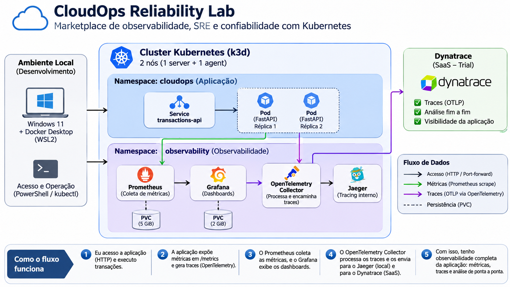

# CloudOps Reliability Lab

**Laboratório prático de SRE, Kubernetes e observabilidade, desenvolvido com foco em aprendizado e documentação reproduzível.**

Neste projeto, construí um ambiente local para simular uma aplicação corporativa de transações, acompanhar seu comportamento e investigar falhas com ferramentas utilizadas em operações de produção. Meu objetivo é consolidar conhecimentos de infraestrutura, confiabilidade e observabilidade, registrando tanto os resultados quanto os problemas encontrados durante a implementação.

> **Estado atual:** laboratório local funcional, com Kubernetes, aplicação FastAPI, métricas Prometheus, dashboards Grafana, tracing com OpenTelemetry e Jaeger e envio de traces ao Dynatrace em ambiente de avaliação. A instrumentação HTTP para SLIs/SLOs está em desenvolvimento e ainda não foi validada como concluída.

## Arquitetura



O ambiente é executado em um computador Windows com Docker Desktop e WSL2. Utilizo um cluster Kubernetes local criado com k3d, composto por um nó servidor e um nó agente. No namespace `cloudops`, a API de transações é executada com duas réplicas e exposta internamente por um Service. No namespace `observability`, mantenho os componentes de monitoramento e tracing.

**Fluxos principais:**

1. Envio requisições HTTP para a API FastAPI por meio de um `kubectl port-forward` local.
2. O Prometheus coleta as métricas expostas pelo endpoint `/metrics` da aplicação.
3. O Grafana consulta o Prometheus para apresentar métricas em dashboards e utiliza o Jaeger como fonte de traces.
4. A aplicação instrumentada com OpenTelemetry envia traces via OTLP ao OpenTelemetry Collector.
5. O Collector encaminha traces para o Jaeger local e para o Dynatrace SaaS, utilizando autenticação armazenada em Secret do Kubernetes.

O diagrama é uma **visão lógica**, não uma representação fixa de quais pods estão alocados em cada nó. O Dynatrace é externo ao cluster e foi utilizado em uma conta de avaliação; a Azure ainda não faz parte do ambiente implementado.

## Tecnologias utilizadas

| Tecnologia | Papel no laboratório |
| --- | --- |
| Windows, WSL2 e Docker Desktop | Ambiente local de execução |
| k3d e Kubernetes (K3s) | Orquestração de contêineres |
| Python e FastAPI | API de simulação de transações |
| Prometheus | Coleta e consulta de métricas |
| Grafana | Visualização de métricas e traces |
| OpenTelemetry | Instrumentação e exportação de traces |
| OpenTelemetry Collector | Recebimento e encaminhamento de telemetria |
| Jaeger | Investigação local de traces distribuídos |
| Dynatrace | Análise de traces em ambiente SaaS de avaliação |
| Git e GitHub | Versionamento e compartilhamento da documentação |

## O que implementei e validei

- Criei um cluster k3d com um nó servidor e um nó agente e validei o funcionamento do Kubernetes.
- Empacotei a API FastAPI em uma imagem Docker e a executei no Kubernetes com duas réplicas, probes de saúde e limites de recursos.
- Disponibilizei endpoints de transações, saúde, métricas e simulação controlada de erro e latência.
- Configurei Prometheus e Grafana e utilizei volumes persistentes (PVCs) para os dados desses componentes.
- Instrumentei a aplicação com OpenTelemetry e visualizei traces no Jaeger.
- Configurei o Collector para encaminhar traces também ao Dynatrace e confirmei a chegada de requisições no explorador de tracing.
- Documentei um teste controlado de exclusão de pod, observando sua recriação pelo controlador do Kubernetes.

Esses testes são **exercícios de laboratório**. A recriação de um pod, isoladamente, não comprova alta disponibilidade nem estabelece um tempo de recuperação mensurado. Da mesma forma, as metas de SLO ainda não devem ser tratadas como resultados alcançados.

## Como explorar o projeto

Para entender o processo de construção, recomendo começar pelo tutorial e depois consultar o incidente documentado:

- [Tutorial técnico completo — instalação, configuração, comandos e validações](docs/tutorial/TUTORIAL-CLOUDOPS-RELIABILITY-LAB.md)
- [INC-001 — Recuperação controlada de um pod](docs/incidents/INC-001-pod-recovery.md)
- [Topologia visual da arquitetura](docs/architecture/cloudops-topology.png)

O tutorial registra a sequência de implementação e os comandos de referência. Algumas etapas dependem da versão das ferramentas e de configurações locais, por isso os procedimentos devem ser revisados antes da reprodução em outro computador.

## Estrutura do repositório

```text
cloudops-reliability-lab/
├── app/                       # Código-fonte da API
├── observability/             # Manifests e configurações de observabilidade
├── docs/
│   ├── architecture/          # Topologia visual
│   ├── incidents/             # Registro de exercícios de incidentes
│   └── tutorial/              # Tutorial técnico
├── requirements.txt           # Dependências Python
└── README.md                  # Apresentação do projeto
```

## Próximas evoluções

- Finalizar, testar e publicar a instrumentação HTTP para métricas por método, rota e código de resposta.
- Definir SLIs e SLOs com janelas de medição explícitas e criar consultas PromQL e dashboards apropriados.
- Implementar alertas e cenários de falha adicionais, registrando evidências e limitações dos testes.
- Avaliar uma evolução para Azure com atenção aos limites de gratuidade e ao controle de custos.

## Segurança e custos

Este laboratório foi planejado com abordagem **local-first**. Credenciais e tokens não devem ser publicados no GitHub; o token utilizado na integração com Dynatrace é referenciado por um Secret no Kubernetes. O uso do Dynatrace depende das condições da conta de avaliação, e uma futura implantação em nuvem exigirá verificação prévia de preços, limites e possíveis cobranças.

## Sobre o projeto

Desenvolvi o **CloudOps Reliability Lab** como parte da minha evolução técnica em infraestrutura e Site Reliability Engineering (SRE). Meu foco é aprender pela prática: implementar, observar, provocar falhas controladas, investigar o comportamento do ambiente e documentar o que realmente consegui validar.
